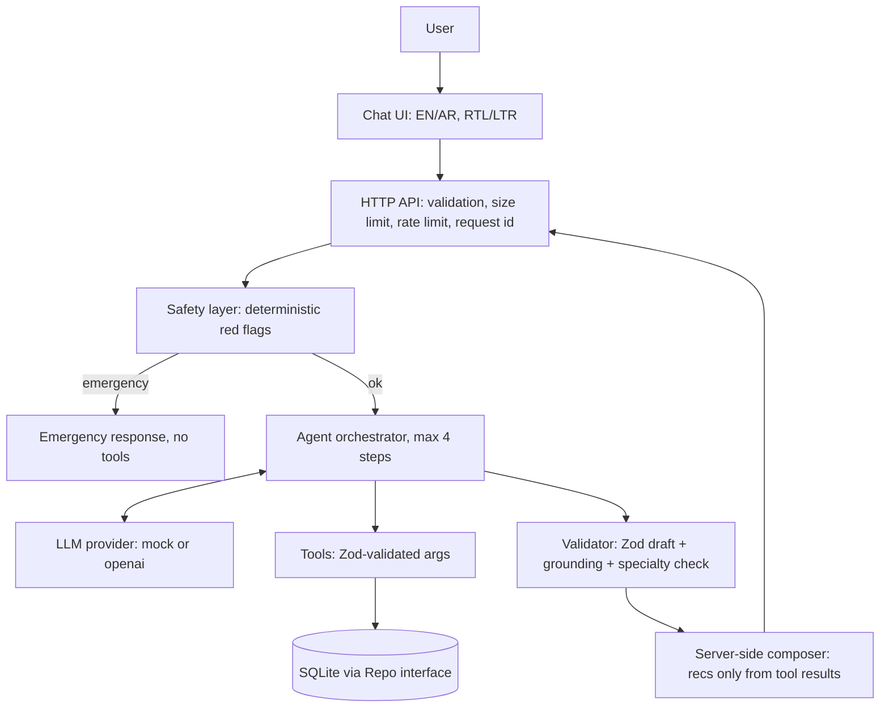

# HealTrip AI Patient Decision Assistant (prototype)

A healthcare **navigation** prototype: emergency escalation, specialty suggestion, doctor/hospital lookup and second-opinion routing. **It never diagnoses.** All doctors/hospitals are **fictional DEMO data**.

## Status: VERIFIED vs UNVERIFIED
| Item | Status |
|---|---|
| 28 automated tests (`npm test`, Node built-in runner) | VERIFIED: 28 pass, 0 fail |
| Server start, SQLite create + migrate + seed, static UI served | VERIFIED (ran with `node src/main.ts`) |
| `/api/chat` EN + AR flows, emergency flow, doctor 404, logs contain no message text | VERIFIED via curl on the live server |
| Browser rendering of the UI (cards, RTL toggle, mobile layout) | **UNVERIFIED** (no browser in build sandbox) |
| `npm install` / `tsc --noEmit` typecheck | **UNVERIFIED** (npm registry blocked; tests ran via Node type-stripping with a local zod copy) |
| OpenAI provider (`src/agent/providers/openai.ts`) | **UNVERIFIED** (no network/key) |
| Prisma / PostgreSQL / Docker / Next.js / Tailwind | **NOT USED** (unavailable). `prisma/schema.prisma` is a reference for migration |

## Stack adaptations (and why)
Sandbox had no npm registry, PostgreSQL or Docker. So: **Node 22 built-ins** (`node:sqlite`, `node:http`, `node:test`, native TypeScript type-stripping) + **Zod**; SQLite instead of Postgres; a dependency-free static frontend instead of Next.js/Tailwind. The layers are kept separable: swap `SqliteRepo` for a Postgres `Repo`, and move the UI into Next.js, without touching the agent.

## Architecture


## Agent flow
1. Safety layer runs first (regex red flags EN/AR, negation-aware, plus yes/no screening answers). A match returns emergency guidance and **no tools run**.
2. Agent loop: the LLM returns either `tool_calls` (which tool + args) or a `final` draft. The orchestrator executes tools against the DB. The LLM never supplies results.
3. The draft is validated (Zod `DecisionDraft`), grounded (no doctor/hospital-looking names that aren't in this turn's tool results; specialty must come from the controlled list), and can only **escalate** to emergency, never downgrade.
4. The server composes the message; `recommendations`, `sources`, `toolCalls` and `disclaimer` are server-generated; the full response is Zod-validated again.

## Tools
`search_doctors`, `search_hospitals`, `search_specialties`, `get_doctor_details`, `get_hospital_details` (`src/tools/index.ts`). Strict Zod args, id regexes (`DOC-###`, `HOSP-###`), error categories only (`invalid_args`, `not_found`, `tool_error`, `unknown_tool`). Example call/result:
```json
{"name":"search_doctors","args":{"specialty":"Cardiology","city":"Riyadh"}}
→ ok, [{"id":"DOC-001","name":"Dr. Layla Demo", ...}, {"id":"DOC-002", ...}]
```

## Anti-hallucination
Backend is the source of truth; LLM output has no doctor/hospital fields; recommendations are copied from tool results only; ungrounded names in LLM text trigger a safe fallback; invented specialties are rejected; empty results yield "I couldn't find a matching … option in the current HealTrip database." Tests: fake doctor, fake hospital, invented specialty, bogus tool, unknown id.

## Safety
Rules (`src/safety/redFlags.ts`): severe chest pain, difficulty breathing, loss of consciousness, severe bleeding, stroke-like signs (EN + AR). **Illustrative only; requires clinical validation before production.** Negation handling ("no difficulty breathing") reduces false alarms but is a known limitation. Chest/neuro/lung specialties trigger a one-time yes/no screening question unless a clinician referral or existing diagnosis is stated; "Yes" escalates.

## Security & error handling
Env-only secrets (`.env.example`, key never sent to browser; `openai` activates only with a real key), Zod input validation, 10 KB body limit, 30 req/min/IP limit, CSP + nosniff headers, no `innerHTML` in UI, parameterized SQL, safe error messages, structured logs with request/session ids, tool names, outcome, latency, and **no message text**. Handled: LLM error/timeout/malformed output, DB failure, tool failure, empty/malformed/oversized request, unsupported language, unknown specialty/id, no results. **No HIPAA claim.** Production would need: auth, encryption at rest/in transit, audit logs, consent, retention policy, BAA with LLM vendor, PHI redaction, clinical governance.

## Arabic / English
UI toggle sets `lang`/`dir` (RTL/LTR); server returns messages, disclaimers and questions in the request language; red-flag rules and specialty keywords include Arabic; cards show Arabic names.

## Run
```bash
cp .env.example .env      # optional; defaults to AI_PROVIDER=mock
npm install               # installs zod (+ typescript/@types/node for typecheck)
npm run seed              # creates data/healtrip.db (idempotent, DEMO data)
npm start                 # http://localhost:3000  (Node >= 22.18)
npm test
```
Env: `AI_PROVIDER` (mock|openai), `OPENAI_API_KEY`, `OPENAI_BASE_URL`, `OPENAI_MODEL`, `PORT`, `DB_PATH`, `LLM_TIMEOUT_MS`.

## Demo scenarios
1. **Emergency:** "I have severe chest pain and difficulty breathing." → emergency guidance, zero tool calls.
2. **Specialist:** "…recurring chest discomfort… my doctor suggested a cardiologist. I'm in Riyadh." → search_specialties → search_doctors + search_hospitals → DB cards.
3. **Second opinion:** "I already received a diagnosis and want another opinion." → asks which area → "my heart" → seek_second_opinion with DB results.

## Known limitations
Prototype rules, keyword-based specialty matching, one specialty per session, in-memory sessions/rate limit, no auth, no availability calendar/ratings/prices (deliberately not modeled), no real LLM run.

## Production roadmap
Postgres + Prisma migrations, Next.js/Tailwind UI, auth + audit trail, Redis sessions, clinician-reviewed triage rules, provider-side moderation, eval suite for the real LLM, observability (OpenTelemetry), compliance review.
