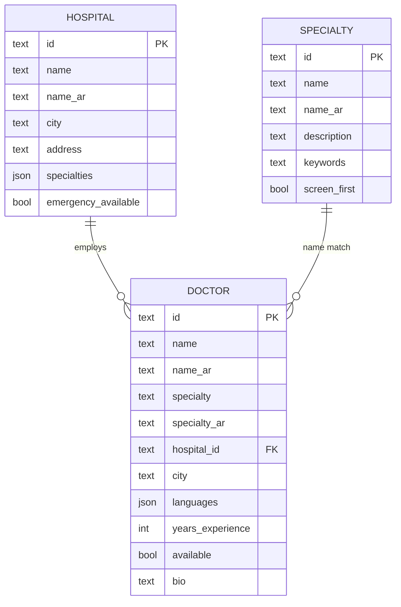

# Database (DEMO DATA, fictional)

Seed is `INSERT OR IGNORE` (idempotent, non-destructive). Array columns are JSON text in SQLite; use `text[]`/join tables in Postgres (`prisma/schema.prisma`, unverified).
